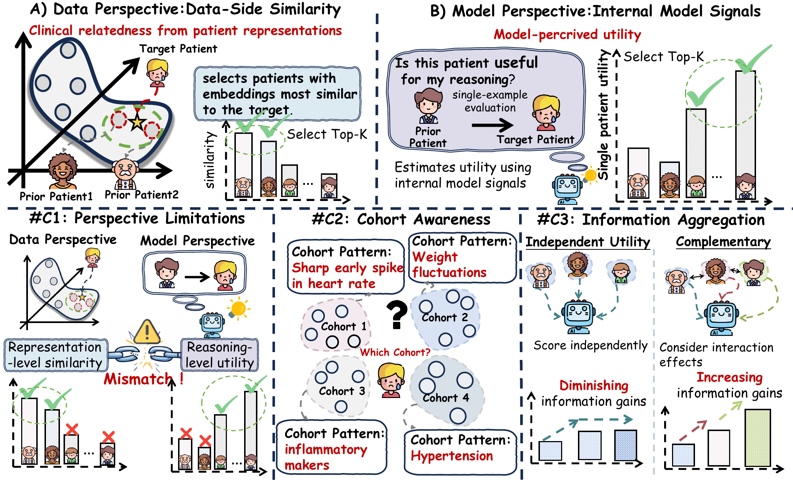
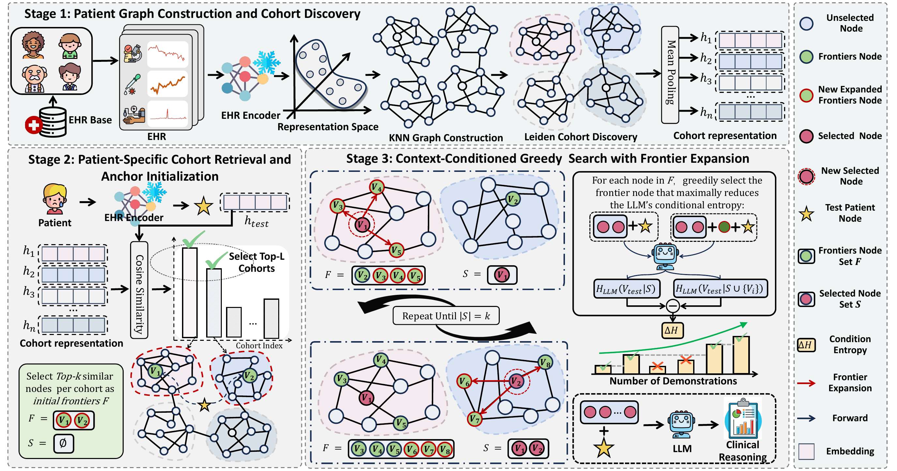

# GraphWalker

**GraphWalker** is a graph-guided in-context learning framework for predicting clinical outcomes from electronic health records. It combines patient representations, cohort retrieval, and full greedy frontier search to select informative demonstrations for a frozen LLM.

The accompanying paper is **The Doctor's Casebook: When LLMs Reason by Patient Analogy via Information Gain-Guided Graph Search**.

## Motivation



## Framework



## Installation

Local GraphWalker inference requires Linux and an NVIDIA GPU with sufficient memory for the chosen LLM. Dependencies are listed in [requirements.txt](requirements.txt).

Download and extract the repository, then run the following commands from its root directory:

```bash
conda create -n ehrbase python=3.10 pip -y
conda activate ehrbase
python -m pip install -r requirements.txt
```

## Usage

Prepare **one hospital admission per JSONL record** in `longitudinal.jsonl` under the dataset directory, together with local LLM and pretrained SMART encoder checkpoints. The default protocol is `--ehr_protocol admission_daily`. The input format is defined below and in [src/data/longitudinal.py](src/data/longitudinal.py). Supply paths through command-line arguments or [src/args/local_path_config.py](src/args/local_path_config.py).

Run from the repository root:

```bash
CUDA_VISIBLE_DEVICES=0,1 python src/main.py \
    --dataset mimic4_readmission \
    --dataset_path /path/to/mimic4 \
    --method graph_walker \
    --llm_name qwen3-14b-instruct \
    --llm_local_path /path/to/Qwen3-14B \
    --use_vllm \
    --embedding_model_name smart \
    --embedding_model_path /path/to/smart/checkpoint-mse.pth \
    --vllm_max_model_len 20480 \
    --seed 3407 \
    --mid_data_dump_path ./mid_data \
    --metrics_save_path ./results/mimic4_readmission/seed-3407.json
```

For zero-shot prediction, use `--method llm_zero_shot` and omit the embedding arguments. View the full set of options with:

```bash
python src/main.py --help
```

Per-run metrics are saved to `--metrics_save_path`. Results across seeds can be aggregated with [summarize_seed_runs.py](src/scripts/graph_walker/summarize_seed_runs.py).

## Admission records and prediction windows

`subject_id` identifies a patient and `hadm_id` identifies a hospital admission.
Multiple admissions for one patient are separate samples, assigned to the same
train/validation/test split. Input measurements are never joined across admissions.
For MIMIC, each admission contains its ICU stays, with measurements recorded only
inside the corresponding stay. Ordinary-ward measurements must not be included.
Example (shown formatted for readability; each admission occupies one JSONL line):

```json
{
  "subject_id": "100", "hadm_id": "200",
  "hospital_admitted_at": "2020-01-01T12:00:00",
  "hospital_discharged_at": "2020-01-05T12:00:00",
  "mortality": 0,
  "feature_names": ["Heart Rate"], "feature_types": ["continuous"],
  "icu_stays": [
    {
      "stay_id": "300",
      "admitted_at": "2020-01-01T14:00:00",
      "discharged_at": "2020-01-03T14:00:00",
      "record_time": [1, 12, 36], "values": [[80], [85], [90]],
      "icu_readmission_30d": 0
    }
  ]
}
```

`record_time` is elapsed hours from **ICU admission**, aligned with the rows of
`values`; ICU intervals must lie within the hospital admission and not overlap.
An optional `subject_id` or `hadm_id` on a stay must match its parent admission.
All ICU stays in that admission are pooled before daily aggregation. The last ICU
stay supplies `icu_readmission_30d`, defined after that stay's discharge; labels
are supplied by upstream outcome ascertainment, never inferred from input rows.
Mortality is admission-level; LOS is derived from the hospital timestamps.

A visit is an **observed calendar day within this admission**, not another
admission or an elapsed 24-hour bin. Following the ClinicRealm preprocessing,
MIMIC uses the last recorded value of each variable per day, and TJH uses the
daily mean for continuous features (the last recorded value for categorical
features). For MIMIC, the final seven observed days are kept and all earlier
observations are merged into one initial step, giving at most eight steps.
TJH retains all observed days without a day cap. Missing values are shown as
NaN in the LLM input; the encoder input uses last observation carried forward
(LOCF) within the same admission, with leading missing values left missing
before normalization. Calendar boundaries use the hospital admission timestamp's
timezone. Days with no measurement rows are not invented.

After aggregation and the dataset-specific window rule, apply the task rule:

| Task | Input | Label |
|---|---|---|
| Mortality | Retained days **before** the final observation day | Death during this hospital admission |
| LOS | Retained days **before** the final observation day | Total hospital LOS bin |
| ICU readmission | All retained ICU days **including** the final observation day, through index ICU discharge | 30-day readmission outcome after index ICU discharge (ClinicRealm definition), supplied by upstream outcome ascertainment |

Measurement times serialized to the LLM are hours since hospital admission,
identifying the last measurement of each step (including the merged initial step).
No target-day values enter either the LLM input or SMART input for mortality/LOS.
For readmission, both representations include the target day. Post-discharge
measurements are rejected.

Prompt wording is preserved verbatim from the experiments (Appendix F).
In that wording, a "visit" refers to an observed calendar day within an admission.
For ICU readmission, the input additionally includes the final observation day
as specified above; the original prompt text is retained for reproducibility.

SMART uses the same daily rows and task cutoff. Supply features in checkpoint
order (17 for MIMIC-III, 44 for MIMIC-IV). If LLM and SMART feature schemas differ,
provide admission-level `smart_feature_names`/`smart_feature_types` and per-stay
`smart_values` on the same `record_time` rows. The one-feature example above is
for illustrating the schema, not a SMART checkpoint input. Normalization is fit
only on training admissions. The low-level TJH admission builder accepts flat
laboratory `values`/`record_time` on the admission, with times relative to hospital
admission; external source/target experiment orchestration remains separate.

**Migration:** the old one-patient/multiple-`visits` format and
`--ehr_protocol historical_visits` are no longer accepted. Export each admission
with its own ID, timestamps, outcomes, and ICU stays. Rebuild processed data;
admission splits use a new `split_v4_subjects_admission_daily_*` namespace.
The legacy `single_stay` adapters remain available for their benchmark workflows
and are not accepted by the daily-admission LLM prompt wrapper.

## CMB-Clin case-level splits

Prepare `cmb_clin.jsonl` with one question per row and a `case_id` shared by **all
questions from the same original clinical case**. Preserve the question, answer,
and other fields needed downstream. Use `--clinical_case_id_field` if the source
uses another explicit case-ID field; question IDs must not be used as case IDs.

The standalone preparation command works without loading an LLM:

```bash
PYTHONPATH=src python -m data.cmb_clin_splits \
    --dataset_path /path/to/cmb_clin \
    --mid_data_dump_path ./mid_data \
    --data_split_seed 3407
```

By default, allocate **83/42/83 questions** to train/validation/test, keeping each
case intact. The allocator uses only case membership and question counts, not
answers. It fails if the requested counts cannot be reached without splitting a
case. For a different corpus, explicitly set `--cmb_clin_split_sizes TRAIN VAL
TEST`. The assignment is deterministic for `data_split_seed`, independent of row
order and the model's experiment seed. Missing case IDs are errors.

Each run writes split pickle files and `split_manifest.json` under
`mid_data/cmb_clin/case_split_v1_<digest>/`. Reuse the exact assignment with
`--cmb_clin_split_manifest /path/to/split_manifest.json`; supplied manifests are
checked for overlap, full coverage, and question counts. The manifest contains
`case_ids` with `train`, `val`, and `test` lists, plus protocol and count metadata.
Old question-level raw/split caches are not reused. Generating this split matches
the paper's grouping and counts; recovering the paper's original case assignment
requires its original manifest. This command prepares data only; it does not add
the separate CMB-Clin LLM inference path.

## Tests

```bash
python -m pip install -r requirements-test.txt
python -m pytest -q tests
```
